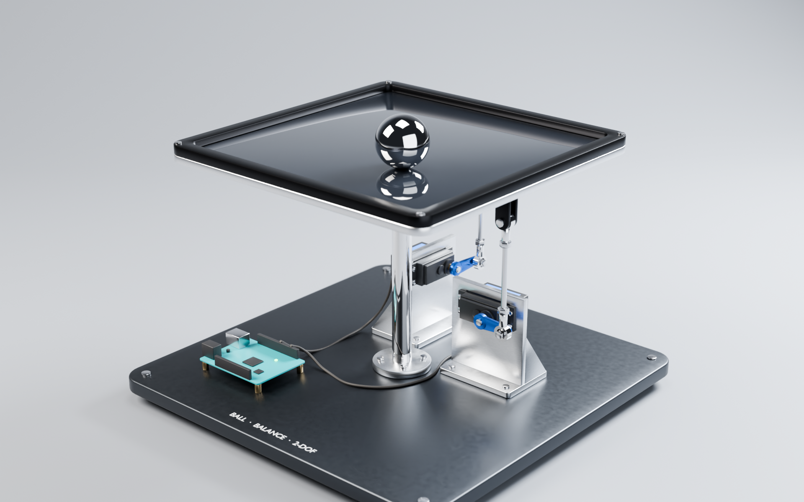
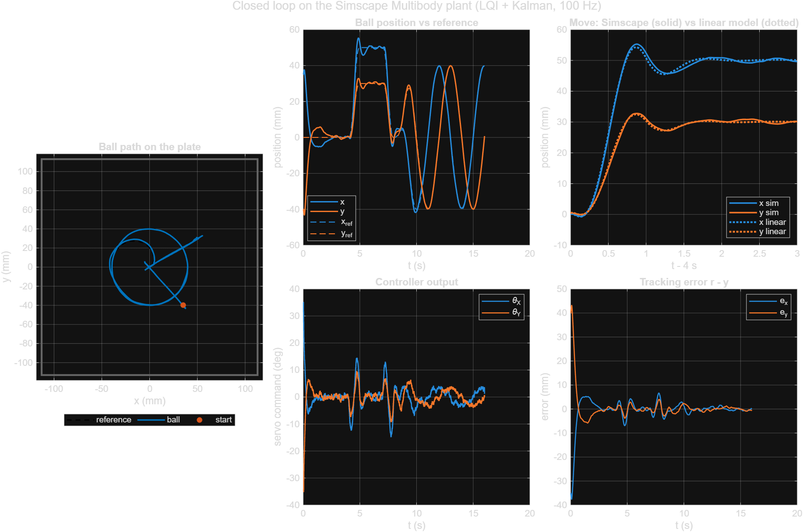

# Ball-on-Plate Balancing Rig

A 2-DOF ball-balancing table, modelled end to end: 3D design in **Blender**, physics in **Simscape Multibody**, and a ball-position controller (**LQI + Kalman filter**) in **MATLAB/Simulink**. Everything is generated from scripts. To change a dimension, edit the script and re-run it; the model, the STL parts, the parameters and the Simulink models all follow.



## The rig

- **Base:** 320 mm anodised plate with a centre post, topped by a universal joint.
- **Plate:** 250 mm aluminium plate with a touch-panel glass top and a 6 mm rim. It pivots on the U-joint 160 mm above the base.
- **Actuation:** two hobby servos (X and Y). Each 25 mm horn drives a push rod (U-joint at the horn end, spherical joint at the plate end) to a clevis 100 mm from the centre. Plate tilt ≈ 0.25 × servo angle, roughly ±14° at full travel.
- **Ball:** 40 mm chrome steel, 263 g.

Axes: world Z up, origin at the centre of the base top surface, SI units. A positive X servo angle lifts the +X edge, so the ball rolls toward −x; the same holds for Y.

## Requirements

- Blender 5.2 (headless use is enough)
- MATLAB R2026b with Simulink, Simscape, Simscape Multibody and Control System Toolbox

## Quick start

```bash
blender --background --factory-startup --python blender/build_ball_balance.py -- . --render
```

Then, in MATLAB, from the `simulink` folder:

```matlab
build_bb_model        % generates ball_balance_sim.slx and ball_balance_cl.slx
run_open_loop_test    % plant check: rolling physics vs theory
design_controller     % linear model, gains, stability margins
run_closed_loop       % controller on the Simscape plant
```

Opening either `.slx` and pressing **Run** shows the 3D animation in Mechanics Explorer. The first simulation takes about 90 s while Simscape compiles the model and loads the STL parts; later runs are much faster, and Fast Restart helps when iterating.

## Project layout

| Path | What it is |
|---|---|
| `blender/build_ball_balance.py` | Builds the whole Blender scene from the dimensions at the top of the file. Writes the `.blend`, the per-body STLs, `cad/bb_geometry.m` and, with `--render`, the renders. |
| `blender/ball_balance.blend` | Generated scene. Pose it by rotating the `F_*` frame empties; the rods follow through constraints. |
| `cad/stl/*.stl` | One STL per rigid body (Base, UJoint_Cross, Plate, Horn_X/Y, Rod_X/Y, Ball), in metres, in the body's joint frame. |
| `cad/bb_geometry.m` | Generated geometry: joint positions and axes, link lengths, plate surface height, ball size, estimated masses and colours. |
| `simulink/bb_params.m` | All simulation parameters: geometry, contact, servo model, controller, test inputs and reference trajectory. Loaded by the models' `InitFcn`. |
| `simulink/bb_controller.m` | Linear model and controller design (LQI gains, Kalman gain, implementation matrices). |
| `simulink/bb_linear_loop.m` | Linear closed loop of one axis, used for analysis and prediction. |
| `simulink/build_bb_model.m` | Generates both Simulink models from library blocks. |
| `simulink/ball_balance_sim.slx` | Open loop: test servo commands → plant. |
| `simulink/ball_balance_cl.slx` | Closed loop: reference → controller → plant. |
| `simulink/run_open_loop_test.m`, `design_controller.m`, `run_closed_loop.m` | Analysis scripts. They write plots to `simulink/results/`. |
| `renders/` | Cycles renders (hero, linkage detail, top view). |

The `.blend`, the `.slx` files, the STLs and `bb_geometry.m` are generated. Edit the scripts instead of those files.

## Plant model

The plant is a closed kinematic loop with no free degrees of freedom, so the two servo angles fully determine the plate pose:

- **U-joint:** two revolute joints (about X, then Y), with the cross piece modelled as its own body.
- **Servos:** each is a revolute joint driven by motion input, behind a hobby-servo model (±60° travel, 0.17 s/60° slew limit, 8 Hz second-order lag).
- **Ball:** a free 6-DOF body, with spatial contact against the glass and the four rim walls. Contact uses a spring-damper normal force with stick-slip friction, so the ball genuinely rolls.

**Plant outputs:**
- `ball_pos` and `ball_vel`, in the plate-surface frame (what a touch panel measures)
- `plate_angle`
- `servo_angle`
- `servo_torque`

Open-loop check: at a fixed tilt, the ball accelerates at (5/7)·g·sin β to within 0.1%, which is rolling without slipping.

## Controller

**Linear model, per axis.** The pivot sits a distance d = 54 mm below the ball centre (including the 2r/5 rolling term):

```
(7/5)·ẍ = −g·sinβ + x·β̇² + (d + 2r/5)·β̈,      β = 0.25·θ
G(s)    = 0.25 · 5/7 · (−g + 0.054·s²) / s²  · servo(s)
```

The β̈ term puts zeros at ±13.5 rad/s, one of them in the right half-plane. They raise the loop gain near crossover, so the design is tuned against this full model, not the bare double integrator.

**Control law.** It runs at 100 Hz, the touch-panel rate, and both axes use the same design:

```
u = −K·[x̂ − r; v̂ − ṙ; ξ] − r̈/c,      ξ = ∫(r − y) dt   (clamped)
```

- **Gains:** K comes from `lqi`.
- **Velocity estimate:** a steady-state Kalman filter estimates v̂ from position measurements with 1 mm noise.
- **Reference:** setpoints are minimum-jerk trajectories with consistent derivatives for the feedforward.

**Results** (full linear model and Simscape plant):

| | |
|---|---|
| Phase / gain / delay margin | 57° / +23.5 dB / 113 ms |
| Hold at (50, 30) mm | 0.9 mm RMS error |
| 40 mm circle, 4 s period | 1.1 mm RMS error |
| Peak plate tilt / servo torque | 5.4° / 0.13 N·m |



## Notes and limitations

- **Masses** in `bb_geometry.m` are volume × density estimates. In Simscape, the File Solid blocks compute inertia from the geometry, scaled to those masses.
- **The rim is low:** after hard impacts, a ball moving fast can ride partway up the 6 mm rim. That's real physics, not a model error.
- **The plate is heavy:** 1.56 kg with 6 mm aluminium and glass. Holding torque is small because the plate is balanced on its pivot, but a thinner plate (`PLATE_T` in the Blender script) eases the servos.
- **Neglected in the controller design:** cross-coupling between axes, the centripetal term and the servo rate limit. All of them are present in the Simscape plant.
